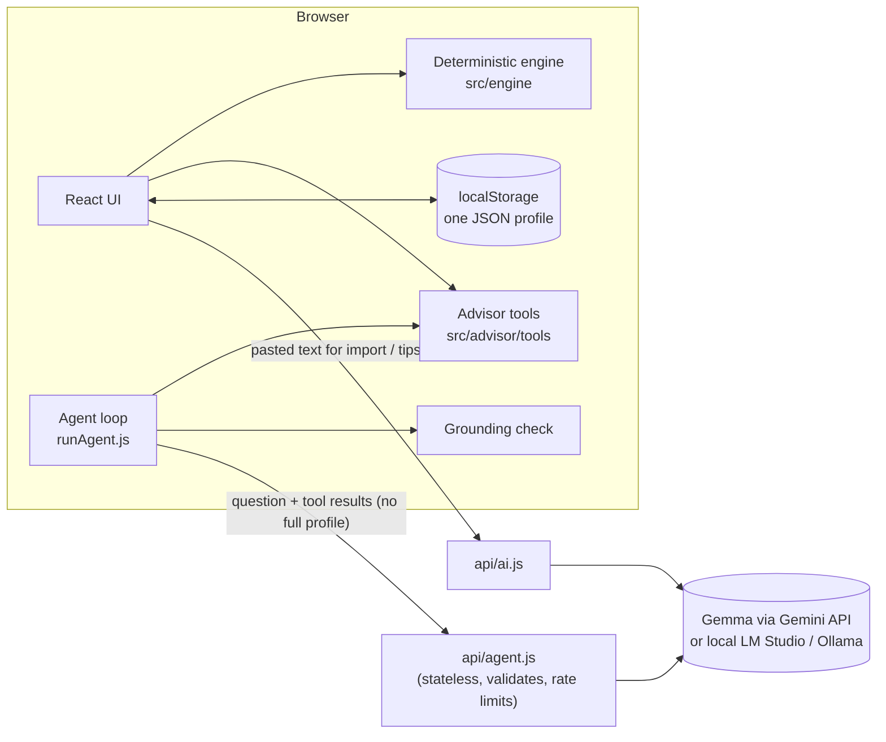

# Lokkho — a CGPA goal tracker for university students

## The problem
Students do not know what marks they need to reach their goal CGPA. They find out after results and get upset. Retake and improvement rules are confusing, and every department and semester has different courses.

## The solution
Pick your program and current semester, tick the courses you registered, enter your goal CGPA and past results. Lokkho then shows what you need next: the average GPA required, the marks needed in the remaining parts of each course (for example how many of the 50 final marks), and which retake raises your CGPA most. Gemma reads messy input (registration slips, marking schemes, what-if questions), writes kind study tips, and powers an **AI Advisor** that answers questions such as "Can I reach my target?" or "Should I retake something?" using the app's own tools.

**All grade maths is plain, tested code. The AI model never calculates grades.** If the AI is down, everything still works by hand.

## How it works
In plain words: the browser keeps one JSON profile (in localStorage). A deterministic engine (`src/engine/`) computes GPA, CGPA, goal math, marks needed, retake gains and exam alerts from one config file (`src/config/grading.config.js`). The server (`api/ai.js`) only forwards pasted text to Gemma, asks for JSON, validates it against a strict schema, and returns it for you to **review and edit before anything is saved**. Study tips get only the engine's numbers, and any tip that contains a number or grade that was not in its input is hidden.

### AI Advisor (agent)
The Advisor tab is a small chat. You ask a question (or press one of four quick buttons: *Can I reach my target?*, *Predict my result*, *What should I get in each course?*, *Should I retake something?*). Gemma decides which **tool** to call, the tool runs **in your browser on your own data**, Gemma reads the result and explains it in plain, kind language (English or Bangla). Each tool used is shown as a small step under the answer.

**The model never does math.** Every number comes from a plain JavaScript tool in `src/advisor/tools/` (one file per tool, listed in `src/advisor/registry.js` with name, description and argument schema):

| Tool | What it returns |
| --- | --- |
| `get_summary` | current CGPA, credits done and left, target CGPA |
| `required_avg` | GPA needed on the remaining credits; says clearly when the target is impossible |
| `marks_needed` | for one course, marks needed in the remaining components for each grade |
| `plan_courses` | a target grade and marks needed for every current course |
| `predict_result` | best, likely and worst semester GPA and CGPA, with the assumptions listed |
| `simulate_retake` | new CGPA if a course is retaken or improved with grade X, or a ranking of retakes |
| `exam_alerts` | mid and final exams in the next 30 days |
| `propose_target` | a *proposal* (new goal CGPA or a course target grade); nothing changes until you press **Apply** |

**How the loop works.** `api/agent.js` is stateless and only asks the model for the *next step*. Function calling is not used; the model follows a prompt-based JSON protocol: `{"tool": name, "args": {...}}` or `{"final": "text"}`. The browser (`src/advisor/runAgent.js`) runs the loop with at most **6 tool calls** per question, one model call of at most 25 seconds per step, and sends only tool results (numbers) back, never the full profile. Bad tool arguments come back to the model as an error it can fix.

**Safety checks.**
- *Grounding check* (`src/advisor/grounding.js`): every number in the final answer must appear in a tool result. If not, the model is asked once to fix its draft; if it still invents numbers, a warning chip lists them. (Whole numbers up to 10, list markers, course codes and the 4.00 scale are not counted as claims.)
- *Write actions are proposals only* with Apply and Dismiss buttons.
- Pasted or typed text is wrapped as untrusted data inside delimiters; server-side validation of every field; input size limits; best-effort in-memory rate limit per IP; the API key stays on the server.
- Predictions are estimates. *Likely* assumes you keep scoring the same share of marks as so far (70% if nothing is marked), *best* assumes full marks on what is left, *worst* assumes 40% of the remaining marks. These are simple assumptions in `src/advisor/config.js`, not facts.

For the Gemma model on the Gemini API, agent calls use `thinkingLevel: minimal` to keep each step to a few seconds (set `AI_THINKING=off` if you use a model that rejects it).

### Architecture

- **Deterministic (plain code, tested):** GPA/CGPA, goal math, marks needed, predictions, retake gains, exam alerts, the IIUC result parser, and the grounding check.
- **AI (Gemma):** reads messy pasted text into JSON (always reviewed by you before saving), writes study tips, picks which tool to call and explains tool results in plain language.

**Model(s) used:** `gemma-4-26b-a4b-it`, an open-weight Gemma model by Google, called through the Gemini API with a key from Google AI Studio ([model page](https://ai.google.dev/gemma)). License: see the official Gemma terms of use on that page (to be confirmed before submission). Optional local mode: run an open model with LM Studio or Ollama and set `AI_PROVIDER=openai_compat`, `AI_BASE_URL`, `AI_MODEL`.

**Honest note about the model.** The core AI feature uses `gemma-4-26b-a4b-it`, an **open-weight** model, but in the hosted demo it is *called through Google's Gemini API* (a hosted service, using a key from Google AI Studio), not run on our own server. The weights are not in this repo. If you want a fully local setup, use the local mode below. The model's exact license is on the official Gemma page and still has to be confirmed before submission; this README does not claim one.

**Local mode (no Google key).** Run an open model in [LM Studio](https://lmstudio.ai) or [Ollama](https://ollama.com), start its OpenAI-compatible server, then put this in `.env.local`:
```
AI_PROVIDER=openai_compat
AI_BASE_URL=http://localhost:1235/v1
AI_MODEL=google/gemma-4-e2b
```
(LM Studio's default port is 1234 and Ollama's is `http://localhost:11434/v1`; use the model name your tool shows.) Then `npm run dev`. Smaller local models may follow the JSON protocol less reliably, so some answers can fail the format check; the app then shows an error and manual entry still works.

**Tech stack:** React + Vite (plain JavaScript, plain CSS), Vitest, Vercel serverless functions (`api/ai.js`, `api/agent.js`: 2 functions).

**Datasets:** none. Sample data only; no real student information is in this repo.

### Assumptions (not confirmed with any university)
These are **configuration, not facts**. They all live in [`src/config/grading.config.js`](src/config/grading.config.js) (look for `verified: false`) and the app shows a "verify with your department" note wherever they matter.

| Assumption | Default | Status |
| --- | --- | --- |
| Marks range per grade | A+ 80-100, A 75-79, A- 70-74, B+ 65-69, B 60-64, B- 55-59, C+ 50-54, C 45-49, D 40-44, F below 40 | **unverified** |
| Points for C, D and F | 2.25, 2.00, 0.00 | **unverified** (A+ to C+ were seen on a real result page) |
| Retake rule | the latest attempt replaces the earlier one; retake-eligible grades F, D, C, C+, B-; no maximum grade after retake | **unverified** (`RETAKE_POLICY`) |
| Attempted vs earned credits | CGPA uses counted credits; earned credits exclude failed courses | **unverified** (`CREDIT_RULE`) |
| Withdrawn (W) | 0 points, credits excluded from GPA and attempted credits | assumed |
| Prediction scenarios | likely = same share of marks as so far (70% if none), best = full marks, worst = 40% of the rest | simple assumptions in `src/advisor/config.js` |

Predictions are **scenario ranges from the marks you entered, not guarantees**.

### Defaults, not official rules
- The **CSE curriculum** is based on one IIUC batch's results page. Other batches may differ. **Verify with your department.** The **BBA curriculum is a SAMPLE** with invented courses.
- The grade scale is a shared default; see **Assumptions** above for everything that is unverified. Grade W (withdrawn) is excluded from credits and GPA.
- GPA and CGPA are shown with 3 decimals; rounding is for display only.

## How to run it
```bash
nvm use            # Node 20
npm install
cp .env.example .env.local   # then fill GEMINI_API_KEY yourself
npm run dev        # app + the same API handlers, no Vercel login needed
npm test
npm run build
npm run check:secrets
```
### Testing
```bash
npm test              # Vitest: engine, parser, tools, grounding, agent loop (mock model), API handlers, UI smoke tests
npm run build
npm run check:secrets # fails if a tracked file looks like it contains a key
```
No test calls a real AI model. A private test for a real result page runs only if you place the page text in `fixtures/private/` (git-ignored); otherwise it is skipped.

### Deploy (Vercel)
1. Sign in to Vercel with GitHub, **Add New Project**, import this repo, framework **Vite**.
2. In Project Settings > Environment Variables add `GEMINI_API_KEY`, `GEMINI_MODEL`, `AI_PROVIDER`, `AI_TIMEOUT_MS`, `AI_MAX_TOKENS` (no quotes around values), then deploy.
3. Redeploy after any env var change. Every push to `main` deploys automatically.
The `api/` folder has 2 functions (`ai.js`, `agent.js`), well inside the Hobby limit; `vercel.json` sets a 30 s `maxDuration` for both and a test checks that every listed file exists.

Environment variables (server side only, never `VITE_`): `AI_PROVIDER` (`gemini` or `openai_compat`), `GEMINI_API_KEY`, `GEMINI_MODEL`, `AI_BASE_URL`, `AI_MODEL`, `AI_TIMEOUT_MS`, `AI_MAX_TOKENS`, `AI_THINKING` (optional).

Privacy: there are no accounts and no database. Your profile is one JSON document in your browser's localStorage and is never stored on our server. Only text you paste into an AI feature, or the numbers the advisor needs, is sent to the model. Use "Reset data" (page footer) to delete it. Do not enter real personal information in the demo.

## Screenshots / demo
_Screenshots will be added in `docs/screenshots/`._ A 2-minute demo script is in [DEMO.md](DEMO.md).

## What's not done yet
- Items marked unverified in **Assumptions** need confirmation from the student's department.
- **Future work: login and cloud sync.** Data lives only in this browser today (no accounts, no database, no sync between devices). A simple email login with a small database is the planned next step, with a privacy review first.
- Photo import is optional and may be incomplete.
- The Gemma license text still has to be confirmed and quoted.
- The GitHub Actions workflow is kept in `ci-pending/ci.yml` until the push token has the `workflow` scope.

## Credits
Built with help from Claude Code. I reviewed the code and can explain it. Gemma by Google. Hacktoberfest Hack Day Chittagong × IEEE CS IIUC SBC.
